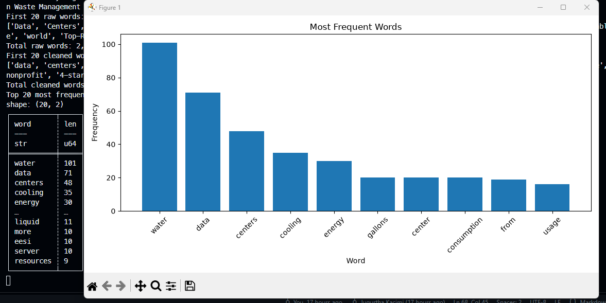
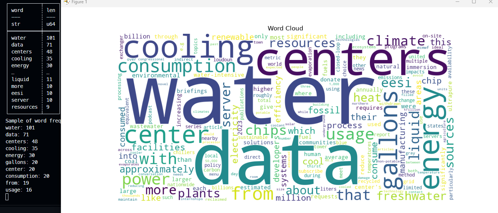

# Web Mining and Applied NLP Project Report

Web Mining and Applied NLP | Project 01

Author: Jugurtha Kacimi
Date: 2026-10

## Overview

This project establishes a professional Python environment
for acquiring and analyzing text from web pages.

The objective is to demonstrate that a Python project can
retrieve web content, extract text, compute word frequencies,
and produce visualizations using a reproducible workflow.

## Data

The data used in this project is retrieved from the Environmental and Energy Study Institute (EESI) article on data centers and water consumption.

Link : [Data Centers and Water Consumption](https://www.eesi.org/articles/view/data-centers-and-water-consumption)

## Tools and Methods

The project uses:

- Python for text acquisition and analysis.
- Requests for retrieving HTML from web pages.
- BeautifulSoup for parsing HTML and extracting text.
- Polars for computing word frequencies.
- Matplotlib for frequency visualizations.
- WordCloud for visual exploration of vocabulary.
- Logging for execution records.
- Ruff, ty, and pytest for code verification.
- Zensical and GitHub Pages for published documentation.

The example script retrieves a EESI article,
extracts text, cleans words,
and calculates token frequencies.

The analysis produces a frequency bar chart
and a word cloud.

## Verification

A successful execution displays:

    Pipeline executed successfully!

The script records execution details in a project log.

These results demonstrate that the environment can
retrieve, process, and visualize web text.

Automated tests provide additional verification
of the project's expected behavior.

## Results

1. Bar chart of the top 10 most frequent words.

2. Word cloud of the most frequent words.

## Observations

The Python script successfully pulled and parsed raw text from the target web article about data centers and water consumption using BeautifulSoup.

Word frequency counting using Polars revealed that the terms "water" and "data" appeared with the highest frequency counts across the entire extracted text body. Secondary terms following the top two included "centers" and "energy".

## Interpretation and Insights

The dominance of "water" and "data" confirms that the text heavily emphasizes the core subject matter of the article, which is the relationship between data centers and their water consumption.

The presence of high-frequency supporting terms like "centers" and "energy" indicates that discussions around data centers are associated with power consumption and environmental impact.

This automated approach proves highly effective for rapidly scanning articles to determine their primary focus areas without needing to read them line by line.

## Limitations and Assumptions

- Scope Limitation: The analysis is restricted to a single web article, meaning the findings cannot be generalized to all literature regarding data center resource consumption.

- Lack of grouping: Variations of words (e.g., singular vs. plural forms like "center" and "centers") are treated as distinct entities rather than grouped into a single root word.

## Next Steps

Expand the pipeline to ingest and compare multiple articles or reports from different environmental organizations to track broader vocabulary trends.

Implement a natural language processing pipeline step (such as grouping or lemmatization) to group related word forms together for a cleaner frequency distribution.

## Documentation Index

- **Home** - this landing page
- [**Project Instructions**](project-instructions.md)
- [**Glossary**](glossary.md)

## Project Links

- [GitHub Repository](https://github.com/denisecase/nlp-01-getting-started)
- [Example Script](https://github.com/denisecase/nlp-01-getting-started/blob/main/src/nlp/web_words.py)
- [Example Notebook](https://github.com/denisecase/nlp-01-getting-started/blob/main/notebooks/web_words.ipynb)

## Project Resources

- [Project Instructions](project-instructions.md)
- [Professional Python Guide](https://denisecase.github.io/pro-analytics-02/)
- [Professional Python Project Explainer](https://pup-pack.github.io/professional-python-project-explainer/)
